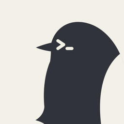
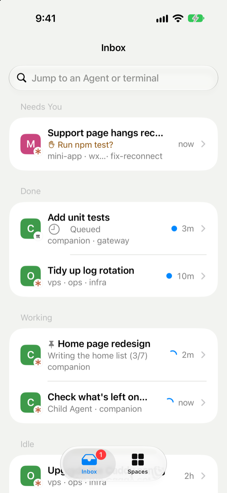
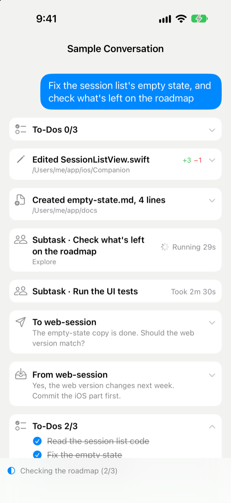
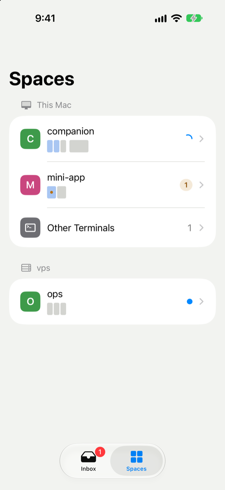

<div align="center">



# Yochi

**Your coding agents, in your pocket.**

An iPhone app for the Claude Code, Codex and pi sessions you run in [Herdr](https://herdr.dev).


English | [简体中文](./README.zh-CN.md)

</div>

<p align="center">
  
  
  
</p>

You leave your desk with three agents working. One finishes, one hits an error, and one has been waiting twenty minutes for you to say yes to `npm test`. With Yochi your phone tells you the moment an agent needs you. You read what it asks, tap Allow, and it carries on. When you have more to say, you write it the way you would in a chat, and it reaches the agent as soon as the agent is free.

Yochi talks to your own Mac and nothing else: there is no account to create and no service of ours in between. It works over Tailscale, or through a small relay you deploy to your own Cloudflare account in one command.

## What it does

- **Who needs you comes first.** The Inbox puts every agent waiting on you at the top, with what it asks: to run a command, to pick an option, to answer a question. It does this across every Space and every machine Herdr reaches.
- **Notifications, without a developer account.** When an agent needs you, fails or finishes, your phone hears about it through the free [Bark](https://bark.day.app) app, encrypted end to end if you like. Tap one to land on that agent. Nothing arrives while Yochi is open, or once you've read the reply on the Mac.
- **Conversations you can read.** A Claude Code session reads like a chat: your messages, its replies, the files it edited with lines added and removed, its sub-tasks and its to-do list.
- **Answer with a tap.** Permission prompts and pickers become cards with real buttons.
- **Reply without grabbing the keyboard.** A message waits until the agent is free, so you never type over someone at the desk. Slash commands complete as you type.
- **A real terminal when you want one.** Every terminal is drawn by [Ghostty](https://ghostty.org). Watch it at the desktop's size, or start typing and it fits your phone, with a key bar for Esc, Ctrl, Tab and the arrows. Full-screen programs scroll under your finger, and a long press copies.
- **See what changed.** Each session's changes in git, diffs included.
- **Start new work.** Start an agent in a recent folder and it lands in the right Space.
- **Organized like Herdr.** Spaces, child agents under their parent, pinned agents first, plain shells tucked away, and remote machines marked.
- **English and Chinese.** Yochi follows your iPhone's language.

## Get started

There is no App Store build yet, so you build the app yourself. You need a Mac running Herdr, with Rust, Xcode and [XcodeGen](https://github.com/yonaskolb/XcodeGen), and either Tailscale on both the Mac and the iPhone or a free Cloudflare account.

1. **Install the Gateway on your Mac.** It starts at login and stays out of your way.

   ```sh
   git clone https://github.com/Moolan-d/yochi && cd yochi
   cargo install --path gateway
   yochi service install
   ```

2. **Put the app on your iPhone.**

   ```sh
   cd ios
   scripts/fetch-libghostty.sh
   xcodegen generate
   open Companion.xcodeproj
   ```

   <details>
   <summary>Signing with your own Apple ID</summary>

   Put your team in `ios/Local.xcconfig`, which git ignores. A free Personal Team also needs a bundle ID suffix:

   ```
   DEVELOPMENT_TEAM = ABCDE12345
   BUNDLE_ID_SUFFIX = .yourname
   ```

   </details>

3. **Pair.** Run `yochi pair` on the Mac and scan the code with the iPhone's camera. The code works once, for five minutes.

<details>
<summary><b>Use it away from your tailnet</b></summary>

Deploy a relay to your own Cloudflare account. It runs on the free plan and only ever sees encrypted bytes.

```sh
yochi relay setup                              # on *.workers.dev
yochi relay setup --domain relay.example.com   # or on your own domain
```

Pair again after this, and the phone uses whichever way is up, preferring Tailscale.

</details>

<details>
<summary><b>Turn on notifications</b></summary>

Install [Bark](https://apps.apple.com/app/id1403753865) on the iPhone, copy its push address, then:

```sh
yochi push bark https://api.day.app/<your-key>/ --encrypt
```

`--encrypt` prints a key to paste into Bark's Push Encryption (AES256, CBC), so neither Bark's server nor Apple can read what your agents are doing. A test notification follows.

</details>

Everything else the `yochi` command can do is in the [Gateway guide](gateway/README.md).

## Privacy and security

- **Only phones you pair can connect.** Pairing codes work once and expire. `yochi devices` lists your phones, and `yochi revoke` cuts one off within seconds.
- **The relay can't read anything.** The phone and your Mac encrypt end to end, and the relay runs in your own account.
- **The phone asks for sessions, not files.** It never names a path or a command on your Mac. It sees changes through a fixed set of read-only git commands.
- **A terminal is still a terminal.** A paired phone can type into the sessions it sees, so treat it like an unlocked laptop.

The details are in the [Gateway guide](gateway/README.md#security-model) and the [protocol](protocol/README.md).

## Contributing

[CONTRIBUTING.md](CONTRIBUTING.md) covers building, testing and how the repository is laid out.

## Acknowledgements

- [Herdr](https://herdr.dev): Yochi is a client of herdr-core and runs on its sessions.
- [Ghostty](https://ghostty.org): libghostty draws every terminal in the app.
- [Heeler](https://github.com/ZingerLittleBee/Heeler) (Apache-2.0): the ANSI screen model and the Claude Code dialog reader are ported from it.
- [Alma Relay](https://github.com/yetone/alma-relay) (MIT): `relay/` is a fork, cut down to the WebSocket tunnel.

## License

Yochi is licensed under the [Apache License 2.0](LICENSE). `relay/` is a fork of Alma Relay and stays under the [MIT License](relay/LICENSE). See [NOTICE](NOTICE) for third-party attributions.
