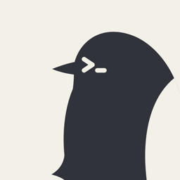
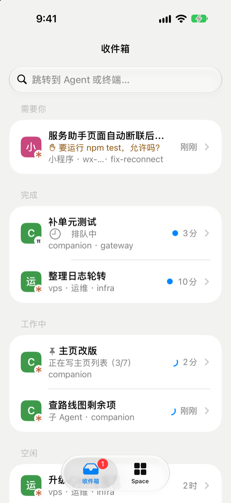
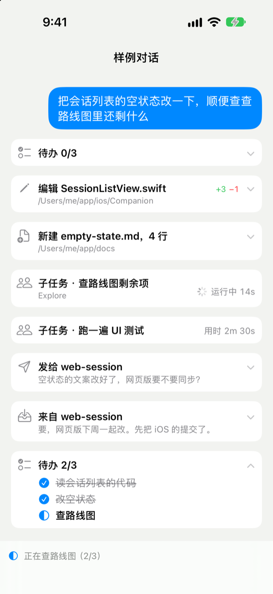
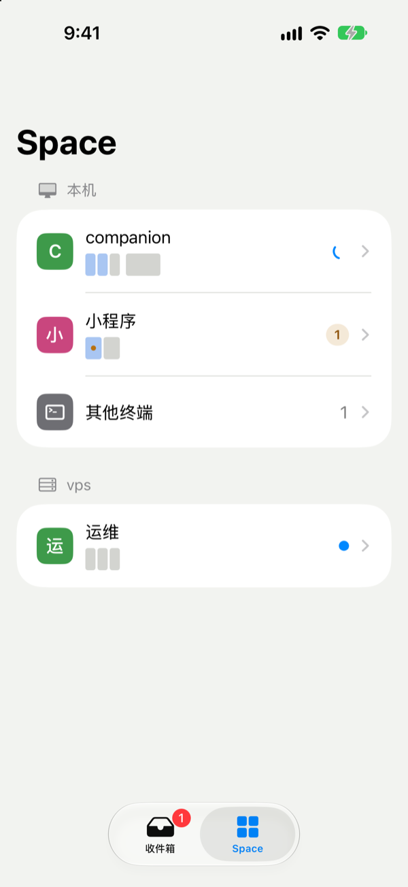

<div align="center">



# Yochi

**把你的编程 Agent 装进口袋。**

在 iPhone 上查看和回复你在 [Herdr](https://herdr.dev) 里跑的 Claude Code、Codex、pi 会话。


[English](./README.md) | 简体中文

</div>

<p align="center">
  
  
  
</p>

你离开电脑时，三个 Agent 还在干活。一个做完了，一个报了错，还有一个等你同意跑 `npm test` 已经等了二十分钟。有了 Yochi，Agent 一需要你，手机就会告诉你。看一眼它问什么，点「允许」，它就接着干。想多交代几句，像聊天一样写下来，Agent 一空下来就会收到。

Yochi 只连你自己的 Mac：不用注册账号，中间也没有我们的服务。它走 Tailscale，或者走你用一条命令部署到自己 Cloudflare 账号上的小中继。

## 能做什么

- **需要你的排在最前。** 收件箱把所有在等你的 Agent 放在顶部，并写明它要什么：跑一条命令、选一个选项、回答一个问题。不管它在哪个 Space、哪台机器上。
- **推送通知，不用开发者账号。** Agent 需要你、出错或做完时，经免费的 [Bark](https://bark.day.app) 推到手机上，可以端到端加密。点开直接进那个 Agent。Yochi 开着时不推，在 Mac 上看过回复后也不推。
- **看得懂的对话。** Claude Code 会话显示成聊天：你的消息、它的回复、它改了哪些文件（增删几行）、它的子任务和待办清单。
- **点一下就能作答。** 权限确认和选择器变成带按钮的卡片。
- **回复不用抢键盘。** 消息等 Agent 空下来才送进去，不会和桌前的人抢着打字。斜杠命令边打边补全。
- **需要时是真正的终端。** 每个终端都由 [Ghostty](https://ghostty.org) 绘制。可以按桌面的尺寸旁观，一打字就换成手机的尺寸，并配有 Esc、Ctrl、Tab 和方向键的按键栏。全屏程序可以用手指翻看，长按复制。
- **看看改了什么。** 每个会话在 git 里的改动，含 diff。
- **开始新工作。** 从最近用过的文件夹启动 Agent，自动归入对应的 Space。
- **按 Herdr 的方式组织。** 按 Space 分组，子 Agent 排在父 Agent 下面，置顶的在前，普通 shell 收起来，远端机器有标记。
- **中文和英文。** 跟随 iPhone 的系统语言。

## 开始使用

目前还没有 App Store 版本，App 需要自己构建。你需要一台运行 Herdr 的 Mac，装好 Xcode 和 [XcodeGen](https://github.com/yonaskolb/XcodeGen)；另外 Mac 和 iPhone 都装 Tailscale，或者准备一个免费的 Cloudflare 账号。Gateway 本身只要有 macOS。

1. **在 Mac 上安装 Gateway。** 它随登录启动，不打扰你。

   ```sh
   curl -fsSL https://raw.githubusercontent.com/Moolan-d/yochi/main/scripts/install.sh | sh
   yochi service install
   ```

   <details>
   <summary>从源码编译 Gateway</summary>

   安装脚本装的是对应这台 Mac 架构的发行版。已装 Rust 的话，也可以用当前的源码自己编译：

   ```sh
   git clone https://github.com/Moolan-d/yochi && cd yochi
   cargo install --path gateway
   yochi service install
   ```
   </details>

2. **把 App 装到 iPhone 上。**

   ```sh
   cd ios
   scripts/fetch-libghostty.sh
   xcodegen generate
   open Yochi.xcodeproj
   ```

   <details>
   <summary>用自己的 Apple ID 签名</summary>

   在 `ios/Local.xcconfig`（git 会忽略它）里填你的团队。免费的 Personal Team 还要加一个 bundle ID 后缀：

   ```
   DEVELOPMENT_TEAM = ABCDE12345
   BUNDLE_ID_SUFFIX = .yourname
   ```

   </details>

3. **配对。** 在 Mac 上运行 `yochi pair`，用 iPhone 相机扫码。配对码单次有效，5 分钟内有效。

<details>
<summary><b>不在 tailnet 上也能用</b></summary>

把中继部署到你自己的 Cloudflare 账号上。免费套餐就够，它只能看到加密后的数据。

```sh
yochi relay setup                              # 部署到 *.workers.dev
yochi relay setup --domain relay.example.com   # 或挂到你自己的域名
```

之后重新配对一次，手机就会走当前能通的那条路，优先 Tailscale。

</details>

<details>
<summary><b>打开推送通知</b></summary>

在 iPhone 上装 [Bark](https://apps.apple.com/app/id1403753865)，复制它的推送地址，然后：

```sh
yochi push bark https://api.day.app/<your-key>/ --encrypt
```

`--encrypt` 会打印一个密钥，填到 Bark 的推送加密（AES256、CBC）里，Bark 的服务器和 Apple 就都看不到 Agent 在做什么。随后会发一条测试通知。

</details>

`yochi` 命令的其他用法见 [Gateway 指南](gateway/README.zh-CN.md)。

## 隐私与安全

- **只有你配对过的手机能连。** 配对码单次有效、会过期。`yochi devices` 列出你的手机，`yochi revoke` 几秒内切断一台。
- **中继什么都看不到。** 手机和 Mac 之间端到端加密，中继也跑在你自己的账号里。
- **手机只要会话，不要文件。** 它从不指定 Mac 上的路径或命令；查看改动用的是一组固定的只读 git 命令。
- **终端终究是终端。** 配对过的手机能在它看到的会话里打字，所以把它当成一台没锁屏的电脑。

细节见 [Gateway 指南](gateway/README.zh-CN.md#安全模型)和[协议](protocol/README.md)。

## 参与开发

构建、测试和仓库结构见 [CONTRIBUTING.md](CONTRIBUTING.md)。

## 致谢

- [Herdr](https://herdr.dev)：Yochi 是 herdr-core 的客户端，跑在它的会话之上。
- [Ghostty](https://ghostty.org)：App 里的每个终端都由 libghostty 绘制。
- [Heeler](https://github.com/ZingerLittleBee/Heeler)（Apache-2.0）：ANSI 屏幕模型和 Claude Code 对话框解析移植自它。
- [Alma Relay](https://github.com/yetone/alma-relay)（MIT）：`relay/` fork 自它，只保留了 WebSocket 隧道。

## 许可证

Yochi 采用 [Apache License 2.0](LICENSE) 许可。`relay/` fork 自 Alma Relay，仍沿用 [MIT 许可](relay/LICENSE)。第三方署名见 [NOTICE](NOTICE)。
