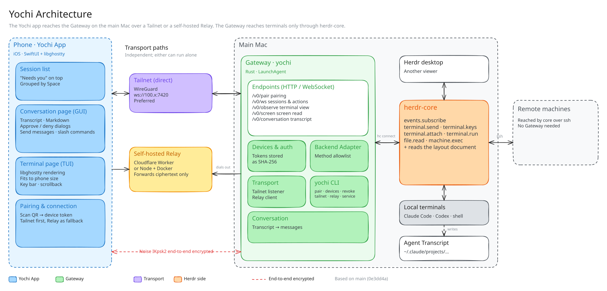
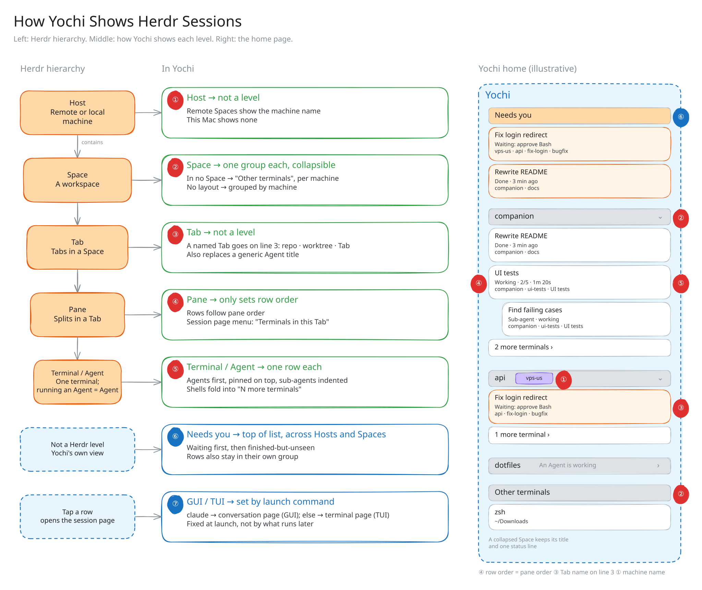

# Yochi Gateway

English | [简体中文](./README.zh-CN.md)

The Gateway is the `yochi` command that runs on your Mac. It reads the sessions herdr-core already manages, including those on machines it reaches over ssh, and serves them to paired iPhones over a narrow, versioned API. The [main README](../README.md) shows how to install it and pair a phone; this page covers how it works and everything the command can do.

## How it fits together

<p align="center">
  
</p>

| Piece | Where it runs | What it does |
| --- | --- | --- |
| **Yochi app** (`ios/`) | iPhone | SwiftUI and libghostty. Session list, conversation page, terminal page and pairing. |
| **Gateway** (`gateway/`) | Your main Mac | The `yochi` binary, in Rust. Authenticates paired phones, exposes a narrow, versioned API (`/v0/…`) and calls herdr-core for them. Runs as a LaunchAgent. |
| **herdr-core** | Your main Mac | Herdr's session runtime, reached through `hc`. It owns the terminals, and the remote machines it reaches over ssh. Yochi creates no second session system. |
| **Relay** (`relay/`) | Your Cloudflare account, or any host with Docker | Optional. A WebSocket rendezvous that the Gateway dials out to, so no inbound port is opened. Forwards ciphertext only. |

Remote machines need nothing installed. Everything goes through the main Mac's herdr-core. When that Mac sleeps, the phone can't reach any session, remote ones included.

### How sessions are shown

<p align="center">
  
</p>

Herdr nests Host → Space → Tab → Pane → Terminal. A phone needs fewer levels:

- A **Space** becomes a group. A **Host** becomes a badge on remote Spaces.
- A **Tab** isn't a level. A named Tab shows as a line on its rows.
- A **Pane** only sets the order. One **Terminal** is one row.

What opens on a tap depends on what runs in the terminal. A known agent opens the conversation page. Anything else opens the terminal page.

## How it connects

| | Tailnet | Relay |
| --- | --- | --- |
| Address | `ws://<Mac's tailnet IPv4>:7420` | `https://<your relay>` |
| Encryption | WireGuard (Tailscale) | Noise IKpsk2, end to end between app and Gateway |
| Phone needs | Tailscale | Nothing extra |
| Mac needs | Tailscale | An outbound connection |
| Turn on or off | `yochi tailnet on\|off` | `yochi relay setup` / `use` / `off` |

The Gateway never listens on the LAN or localhost, and the tailnet is preferred whenever both are up. Being able to reach the Gateway isn't authorization: every connection still needs a paired device's token.

## CLI reference

```text
yochi [OPTIONS] [COMMAND]
```

| Command | What it does |
| --- | --- |
| `yochi` / `yochi serve` | Run the Gateway in the foreground (the default) |
| `yochi pair` | Show a single-use pairing code and QR code, valid for five minutes |
| `yochi devices` | List paired devices |
| `yochi revoke <ID>` | Unpair a device. Its open connections close within seconds |
| `yochi tailnet on` | Listen on the tailnet whenever this Mac is on it (the default) |
| `yochi tailnet off` | Stop listening on the tailnet and close its connections. Phones then come in only through the Relay |
| `yochi tailnet status` | Whether the tailnet is on, this Mac's address and whether the Gateway is listening there |
| `yochi relay setup [--domain <host>] [--name <worker>]` | Deploy a Relay to your Cloudflare account (Workers, free plan) and use it. Needs Node.js. wrangler asks you to log in the first time |
| `yochi relay use <URL> [--key <KEY>]` | Use a Relay you already run. The running Gateway connects within seconds |
| `yochi relay status` | The Relay in use, whether the Gateway is connected and how many phones can use it |
| `yochi relay rotate` | Move this Gateway to a new address on the Relay. The old one, and pairing links that carry it, stop working |
| `yochi relay off` | Stop using the Relay |
| `yochi push bark <KEY or URL> [--encrypt \| --key <KEY>] [--server <URL>]` | Notify the phone through Bark when an agent needs you or finishes, and send a test notification. `--encrypt` makes a new key for Bark's Push Encryption |
| `yochi push test` | Send a test notification |
| `yochi push status` | Where notifications go, and whether they're encrypted |
| `yochi push off` | Stop sending notifications |
| `yochi service install` | Install or update the LaunchAgent and start it, with the current settings |
| `yochi service status` | Whether the LaunchAgent is installed and running, where it listens and where it logs |
| `yochi service uninstall` | Stop the LaunchAgent and remove it |

| Option | Environment | Default |
| --- | --- | --- |
| `--listen <ADDR>` | `YOCHI_LISTEN` | This Mac's tailnet IPv4, port `7420` |
| `--hc <PATH>` | `YOCHI_HC` | `hc` |
| `--state-dir <DIR>` | `YOCHI_STATE_DIR` | `~/Library/Application Support/Yochi` |
| `--key <KEY>` (`relay use`) | `YOCHI_RELAY_KEY` | none |
| `--key <KEY>` (`push bark`) | `YOCHI_BARK_KEY` | none |

<details>
<summary><b>Notes on running it as a service</b></summary>

- `service install` records the absolute paths of `hc` and `tailscale`, since launchd doesn't inherit your shell's `PATH`, along with any `--listen` and `--state-dir` you pass.
- It refuses to install while another Gateway holds the port, so stop that one first.
- Logs go to `~/Library/Logs/Yochi/gateway.log`.
- If Tailscale is off or missing, the Gateway keeps serving through the Relay. It looks for a tailnet address every 5 seconds and starts listening there once one appears.
- With the tailnet off, `yochi pair` puts only Relay details in its link, so the phone doesn't need Tailscale. When the tailnet comes back, already-paired phones learn its address and switch over on their own.
- Upgrading from `companion-gateway`: `yochi service install` removes the old `dev.companion.gateway` agent, and pairings move from `~/Library/Application Support/Companion Gateway`. The iOS bundle ID is now `dev.yochi.app`, so the app installs as a new app and you'll need to pair again.

</details>

## Security model

- **Paired devices only.** Every endpoint except `/v0/pair` needs a device token. Pairing codes are single-use, last five minutes and are void after five wrong tries. `yochi revoke` cuts a device off within seconds.
- **A narrow API, not a proxy.** The Gateway allows a short list of herdr-core methods (`events.subscribe`, `terminal.*`, `file.read`, `machine.exec`) and uses the last two only internally: to read agent transcripts and to run a fixed set of read-only git commands. The phone never names a file path or a command.
- **The terminal is still a terminal.** A paired phone can type into the sessions it sees, and a shell can do anything your account can. Treat pairing like handing over an unlocked laptop, and revoke devices you no longer hold.
- **The Relay can't read your traffic.** App and Gateway run Noise IKpsk2 end to end. The pairing link carries the Gateway's static key and a one-time secret. The Relay forwards opaque frames and needs only a registration key, which you generate. It runs in your own account.

The wire protocol is in [`protocol/README.md`](../protocol/README.md).
