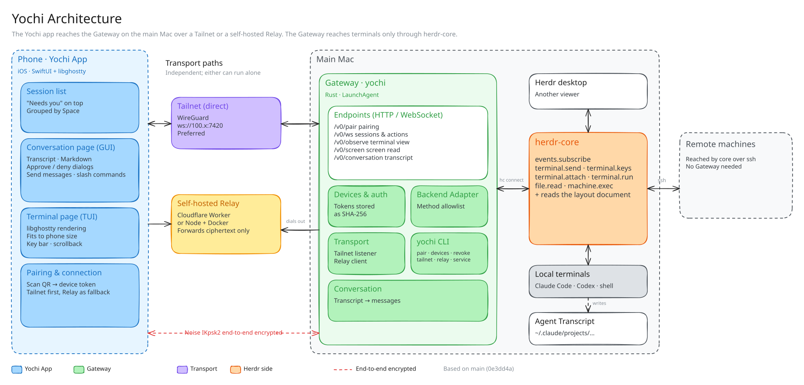
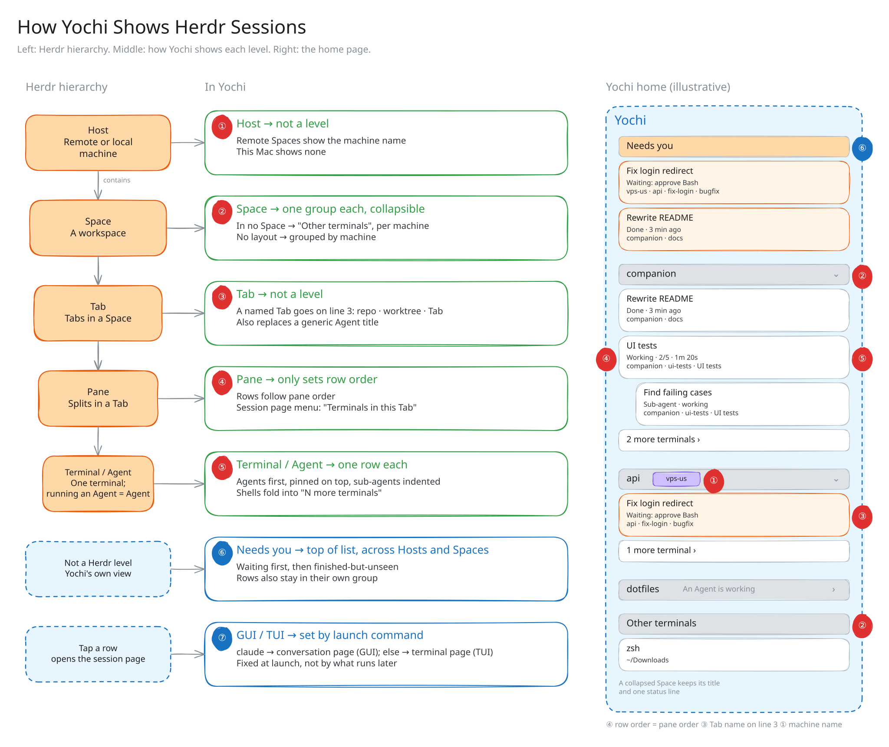

# Yochi Gateway

[English](./README.md) | 简体中文

Gateway 就是跑在 Mac 上的 `yochi` 命令。它读取 herdr-core 已经在管理的会话（包括 herdr-core 经 ssh 连到的机器上的），经一组窄而有版本的接口交给已配对的 iPhone。安装和配对见[主 README](../README.zh-CN.md)；这一页讲它怎么工作，以及这个命令能做的所有事。

## 整体结构

<p align="center">
  
</p>

| 组件 | 运行位置 | 作用 |
| --- | --- | --- |
| **Yochi App**（`ios/`） | iPhone | SwiftUI + libghostty。会话列表、对话页、终端页、配对。 |
| **Gateway**（`gateway/`） | 主 Mac | Rust 写的 `yochi`。认证已配对的手机，暴露一组窄而有版本的接口（`/v0/…`），替它们调用 herdr-core。以 LaunchAgent 常驻。 |
| **herdr-core** | 主 Mac | Herdr 的会话运行时，经 `hc` 访问。终端归它所有，远端机器也由它经 ssh 连接。Yochi 不另建第二套会话系统。 |
| **Relay**（`relay/`） | 你的 Cloudflare 账号，或任何能跑 Docker 的主机 | 可选。Gateway 主动外连的 WebSocket 中转，不需要开放入站端口。只转发密文。 |

远端机器什么都不用装，全部经主 Mac 的 herdr-core 访问。主 Mac 睡眠时，手机访问不到任何会话，包括远端机器上的。

### 会话如何显示

<p align="center">
  
</p>

Herdr 的层级是 Host → Space → Tab → Pane → Terminal。手机上用不了这么多层：

- **Space** 是分组。**Host** 是远端 Space 上的机器标记。
- **Tab** 不成一层，有名字的 Tab 显示为行内的一行字。
- **Pane** 只决定排序。一个 **Terminal** 是一行。

点开后进哪一页，取决于终端里跑的程序：已知的 Agent 进对话页，其余进终端页。

## 连接方式

| | Tailnet | Relay |
| --- | --- | --- |
| 地址 | `ws://<Mac 的 tailnet IPv4>:7420` | `https://<你的 relay>` |
| 加密 | WireGuard（Tailscale） | Noise IKpsk2，App 与 Gateway 之间端到端 |
| 手机需要 | Tailscale | 不需要额外的东西 |
| Mac 需要 | Tailscale | 能连出去 |
| 开关 | `yochi tailnet on\|off` | `yochi relay setup` / `use` / `off` |

Gateway 从不监听局域网或 localhost。两条路径都通时优先走 tailnet。能连上 Gateway 不等于有权限：每个连接都要带已配对设备的 token。

## CLI 参考

```text
yochi [OPTIONS] [COMMAND]
```

| 命令 | 作用 |
| --- | --- |
| `yochi` / `yochi serve` | 在前台运行 Gateway（默认） |
| `yochi pair` | 显示单次有效的配对码和二维码，5 分钟内有效 |
| `yochi devices` | 列出已配对的设备 |
| `yochi revoke <ID>` | 取消某台设备的配对，它已建立的连接几秒内关闭 |
| `yochi tailnet on` | Mac 在 tailnet 上时就在 tailnet 上监听（默认） |
| `yochi tailnet off` | 不在 tailnet 上监听，并关闭已有的 tailnet 连接，手机只能经 Relay 连接 |
| `yochi tailnet status` | tailnet 是否开着、本机地址、Gateway 是否在监听 |
| `yochi relay setup [--domain <host>] [--name <worker>]` | 部署 Relay 到你的 Cloudflare 账号（Workers 免费套餐）并启用。需要 Node.js，第一次会让 wrangler 登录 |
| `yochi relay use <URL> [--key <KEY>]` | 使用你已经部署的 Relay，运行中的 Gateway 几秒内连上 |
| `yochi relay status` | 正在用的 Relay、Gateway 是否已连上、多少台手机能用它 |
| `yochi relay rotate` | 给 Gateway 换一个 Relay 上的地址。旧地址和带着它的配对链接随之失效 |
| `yochi relay off` | 停用 Relay |
| `yochi push bark <KEY 或 URL> [--encrypt \| --key <KEY>] [--server <URL>]` | Agent 需要你或做完时经 Bark 推送到手机，并发一条测试通知。`--encrypt` 为 Bark 的推送加密生成新密钥 |
| `yochi push test` | 发一条测试通知 |
| `yochi push status` | 通知发到哪里、是否加密 |
| `yochi push off` | 停止发送通知 |
| `yochi service install` | 安装或更新 LaunchAgent 并启动，沿用当前的设置 |
| `yochi service status` | LaunchAgent 是否装了、是否在运行、监听地址、日志位置 |
| `yochi service uninstall` | 停止并移除 LaunchAgent |

| 选项 | 环境变量 | 默认值 |
| --- | --- | --- |
| `--listen <ADDR>` | `YOCHI_LISTEN` | 本机 tailnet IPv4，端口 `7420` |
| `--hc <PATH>` | `YOCHI_HC` | `hc` |
| `--state-dir <DIR>` | `YOCHI_STATE_DIR` | `~/Library/Application Support/Yochi` |
| `--key <KEY>`（`relay use`） | `YOCHI_RELAY_KEY` | 无 |
| `--key <KEY>`（`push bark`） | `YOCHI_BARK_KEY` | 无 |

<details>
<summary><b>常驻运行的细节</b></summary>

- `service install` 会记下 `hc` 和 `tailscale`（装了的话）的绝对路径，因为 launchd 不继承 shell 的 `PATH`。显式传入的 `--listen`、`--state-dir` 也会记下。
- 已有 Gateway 占着端口时，安装会拒绝，先停掉它。
- 日志在 `~/Library/Logs/Yochi/gateway.log`。
- Mac 上的 Tailscale 没开或没装时，Gateway 不退出，照常经 Relay 服务。它每 5 秒找一次 tailnet 地址，找到后再在 tailnet 上监听。
- tailnet 关着时，`yochi pair` 的链接只带 Relay 信息，手机不需要装 Tailscale。tailnet 恢复后，Gateway 把地址告诉已配对的手机，手机自动改走 tailnet。
- 从改名前的版本（`companion-gateway`）升级：
  - `yochi service install` 会先移除旧的 `dev.companion.gateway`。
  - 配对记录从 `~/Library/Application Support/Companion Gateway` 迁过来。
  - iOS 的 bundle ID 改成了 `dev.yochi.app`，手机上会装成一个新 App，需要重新配对，旧 App 可以删掉。

</details>

## 安全模型

- **只认已配对的设备。** 除 `/v0/pair` 外，所有接口都要带设备 token。配对码单次有效、5 分钟过期、输错 5 次作废。`yochi revoke` 几秒内切断设备。
- **窄接口，不是代理。** Gateway 只放行几个 herdr-core 方法（`events.subscribe`、`terminal.*`、`file.read`、`machine.exec`）。后两个只在内部使用：读 Agent 对话记录，跑一组固定的只读 git 命令。手机从不指定文件路径或命令。
- **终端终究是终端。** 已配对的手机可以在它看到的会话里打字，而 shell 能做你账号能做的任何事。配对等于交出一台没锁屏的电脑，手机不在手上了就撤销它。
- **Relay 看不到内容。**
  - App 与 Gateway 之间跑 Noise IKpsk2 端到端加密。
  - 配对链接带着 Gateway 的静态公钥和一次性密钥。
  - Relay 只转发不透明的帧，需要的只是你自己生成的注册密钥，部署在你自己的账号里。

协议见 [`protocol/README.md`](../protocol/README.md)。
